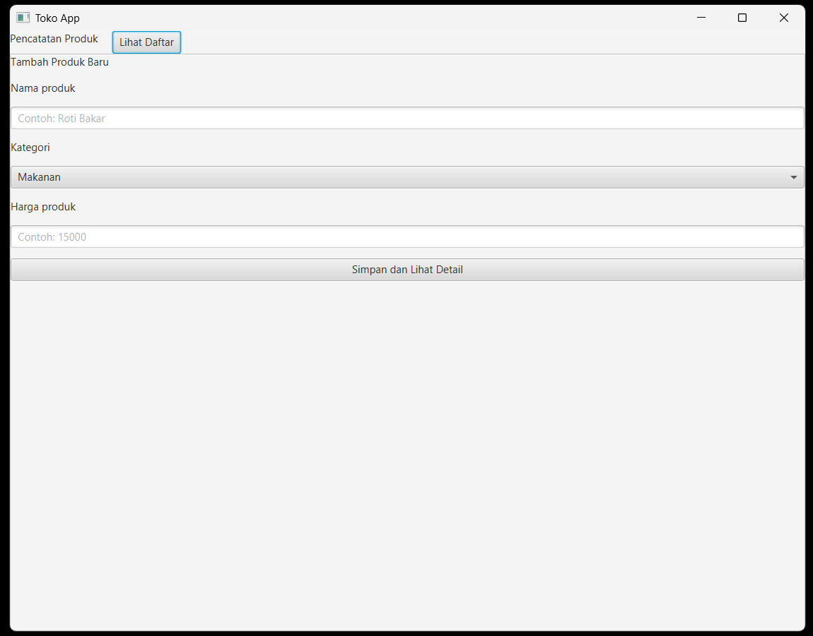
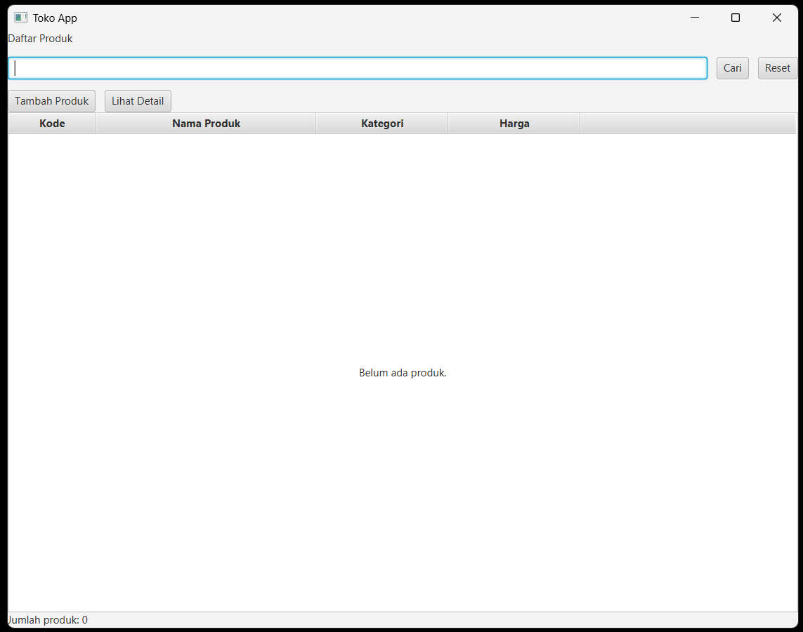

# Toko App - JavaFX

Aplikasi desktop pencatatan dan pengelolaan data produk sederhana yang dibangun menggunakan Java, Maven, dan JavaFX[cite: 1].

## Screenshot Aplikasi

**Scene 1: Daftar Produk**


**Scene 2: Form Pencatatan Produk**


## Persyaratan Sistem
* Java Development Kit (JDK) 21
* Apache Maven[cite: 1]
* Apache NetBeans (untuk mode pengembangan)

## Cara Menjalankan Aplikasi

**Melalui Terminal / Command Prompt:**
1. Buka terminal dan arahkan direktori ke folder project ini.
2. Jalankan perintah berikut:
   ```bash
   mvn clean javafx:run
